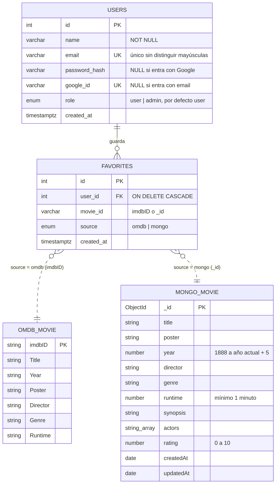

# 🎬 Film App

Aplicación web de búsqueda y gestión de películas, con renderizado en servidor (SSR) y diseño *mobile-first*. Proyecto en equipo del curso de **The Bridge**.

Los usuarios buscan películas, ven su ficha y guardan sus favoritas. El administrador gestiona el catálogo propio de películas (las que no están en OMDB) y los usuarios de la plataforma.

> El enunciado original del proyecto está en [`docs/ENUNCIADO.md`](docs/ENUNCIADO.md).

---

## 👥 Equipo

- Borja Jiménez
- Mariela Velasquez
- Leonardo Delgado
- Daniel Lopez

---

## 🧰 Tecnologías

| Parte | Tecnología |
|---|---|
| Servidor | Node.js + Express 5 |
| Vistas (SSR) | Pug + CSS propio (mobile-first) |
| BBDD relacional | PostgreSQL en Supabase (`pg`) — usuarios y favoritos |
| BBDD no relacional | MongoDB (`mongoose`) — películas creadas por el admin |
| API externa | [OMDB API](http://www.omdbapi.com/) |
| Autenticación | JWT en cookie `httpOnly` + contraseñas con `bcrypt` + OAuth con Google |
| Documentación | Swagger (`swagger-jsdoc` + `swagger-ui-express`) y JSDoc |
| Tests | Jest + Supertest |

---

## ✨ Funcionalidades

### Usuario
- Registro con email y contraseña, o inicio de sesión con Google.
- **Dashboard** con acceso al buscador y a sus películas.
- **Buscador** de películas por título, con tarjetas y botón *Añadir a favoritos*.
- **Vista detalle** de la película (sinopsis, actores, valoración…).
- **Mis películas**: lista de favoritas con botón *Quitar*.
- **Perfil**: ver y editar sus datos.

### Administrador
- **Gestionar películas** (MongoDB): listado, crear, editar con formulario ya relleno y borrar con confirmación. Al borrar una película se borran también los favoritos asociados.
- **Gestionar usuarios**: CRUD completo desde la vista `/users`.
- **Perfil**: ver y editar sus datos.

### Control de acceso
- Cualquier vista privada sin sesión redirige a `/`; la API privada responde `401`.
- Cada rol solo entra en sus vistas: si un usuario abre una vista de admin (o al revés), vuelve a su página de inicio (usuario → `/dashboard`, admin → `/movies`).
- Menú hamburguesa con efecto persiana, distinto según el rol.

---

## 🔎 Cómo funciona la búsqueda

Para el usuario es transparente de dónde vienen los datos de la película:

1. Se busca primero en **OMDB**. Si aparece, se muestra **sin guardarla** en ninguna base de datos.
2. Si no está en OMDB, se busca en **MongoDB** (catálogo del admin).
3. Si no está en ninguno, se muestra *"No hay resultados"*.

Al añadir una favorita **no se copian los datos de la película**: en SQL solo se guarda qué usuario la guardó, su id (`imdbID` o `_id`) y de qué fuente viene (`omdb` o `mongo`). Al listar los favoritos, los datos se piden a su fuente original.

---

## 🗂️ Modelo de datos



| Relación | Cardinalidad | Detalle |
|---|---|---|
| Usuario → Favoritos | 1 : 0..N | Un usuario nuevo no tiene favoritos; `user_id` es `NOT NULL` |
| Favorito → Película | 0..N : 1 | Cada favorito apunta a una sola película, en OMDB o en MongoDB según `source` |
| Usuario ↔ Película | N : M | Resuelta con la tabla intermedia `favorites` |

**Decisiones de diseño**

- **Sin redundancia:** `favorites` guarda la relación (`movie_id` + `source`), nunca los datos de la película.
- **Relación polimórfica:** `movie_id` no tiene `FOREIGN KEY` porque la película vive fuera de PostgreSQL (OMDB o MongoDB); su existencia la comprueba el código.
- **Sin duplicados:** `UNIQUE (user_id, movie_id, source)`.
- **Dos formas de login:** `password_hash` y `google_id` pueden ser `NULL`, pero el `CHECK` obliga a tener al menos uno.
- **Email único real:** índice único sobre `LOWER(email)`.
- **Borrado en cascada:** al borrar un usuario se borran sus favoritos.

El esquema completo está en [`docs/schema.sql`](docs/schema.sql).

---

## 📁 Estructura del proyecto

```
├── app.js              # Punto de entrada: middlewares, rutas y arranque
├── config/             # Conexiones (SQL, MongoDB), sesión JWT, OAuth y Swagger
├── controllers/        # Reciben la petición y devuelven la respuesta
├── services/           # Lógica de negocio (búsqueda, OMDB, favoritos, sesión)
├── models/             # Acceso a datos: users y favorites (SQL), movie (Mongoose)
├── middlewares/        # isAuthenticated y checkRole
├── routes/             # Rutas de vistas y de la API (con anotaciones Swagger)
├── views/              # Plantillas Pug
├── public/             # CSS y JS del navegador
├── test/               # Tests con Jest + Supertest
└── docs/               # Enunciado, esquema SQL, tareas y guía de Trello
```

---

## 🚀 Instalación y puesta en marcha

### Requisitos

- Node.js 18 o superior
- Un proyecto de **Supabase** (PostgreSQL)
- Una base de datos **MongoDB** (por ejemplo, MongoDB Atlas)
- Una **API key de OMDB** ([pedirla aquí](http://www.omdbapi.com/apikey.aspx))
- Credenciales OAuth de **Google** (solo para el login con Google)

### 1. Clonar e instalar

```bash
git clone https://github.com/maridev-ve/proyecto-backend-Film-App.git
cd proyecto-backend-Film-App
npm install
```

### 2. Variables de entorno

Copia `.env.example` a `.env` y rellénalo:

| Variable | Obligatoria | Descripción |
|---|---|---|
| `JWT_SECRET` | Sí | Secreto para firmar los JWT |
| `DATABASE_URL` | Sí | Cadena de conexión de PostgreSQL (Supabase) |
| `MONGO_URI` | Sí | Cadena de conexión de MongoDB |
| `OMDB_API_KEY` | Sí | API key de OMDB |
| `GOOGLE_CLIENT_ID` | Para Google | Client ID de OAuth |
| `GOOGLE_CLIENT_SECRET` | Para Google | Client secret de OAuth |
| `GOOGLE_CALLBACK_URL` | Para Google | Por ejemplo `http://localhost:3000/api/auth/google/callback` |
| `PORT` | No | Puerto del servidor (por defecto `3000`) |
| `JWT_EXPIRES_IN` | No | Duración del token (por defecto `1d`) |

> ⚠️ Nunca subas el archivo `.env` al repositorio.

### 3. Crear las tablas SQL

Abre el **SQL Editor** de Supabase, pega el contenido de [`docs/schema.sql`](docs/schema.sql) y ejecútalo. Crea los tipos, las tablas `users` y `favorites` y activa Row Level Security.

Al final del archivo hay un bloque opcional (comentado) con dos usuarios de prueba:

| Rol | Email | Contraseña |
|---|---|---|
| Usuario | `lucia@filmapp.test` | `123456` |
| Admin | `admin@filmapp.test` | `123456` |

### 4. Arrancar

```bash
npm run dev     # desarrollo, con nodemon
npm start       # producción
```

La app queda en <http://localhost:3000>. El servidor solo arranca si consigue conectar con MongoDB.

### 5. Tests

```bash
npm test             # lanza todos los tests (unitarios + e2e)
npm run test:e2e     # solo los e2e
npm run test:watch   # modo watch
```

Hay dos tipos de tests en [`test/`](test/):

- **Unitarios** (`test/*.test.js`): cada pieza por separado (controladores, middlewares, servicios, modelos), con la base de datos simulada.
- **E2E** (`test/e2e/`): recorren los flujos principales con la app entera y peticiones HTTP reales, como el navegador (con la cookie de sesión):
  - `usuario.e2e.test.js`: registro → buscar → detalle → favoritos → quitar → logout, login y perfil.
  - `admin.e2e.test.js`: crear, editar y borrar películas (y sus favoritos), y gestión de usuarios.
  - `acceso.e2e.test.js`: control de acceso sin sesión, por rol y con tokens no válidos.

Los e2e **no tocan Supabase ni el Mongo real** y no necesitan `.env`:
- PostgreSQL se sustituye por [pg-mem](https://github.com/oguimbal/pg-mem), que carga el esquema real de `docs/schema.sql`.
- MongoDB se sustituye por [mongodb-memory-server](https://github.com/typegoose/mongodb-memory-server).
- OMDB se simula con un catálogo fijo.

La primera vez que se lanzan, mongodb-memory-server descarga el binario de `mongod` (unos 100 MB) y tarda un poco más.

---

## 🧭 Endpoints

### Vistas (Pug)

| Ruta | Acceso | Descripción |
|---|---|---|
| `GET /` | Público | Inicio |
| `GET /login` | Público | Formulario de login |
| `GET /signup` | Público | Formulario de registro |
| `GET /dashboard` | Usuario | Panel de control |
| `GET /search` | Usuario | Buscador de películas |
| `GET /search/:title` | Usuario | Detalle de una película |
| `GET /favorites` | Usuario | Películas favoritas |
| `GET /movies` | Usuario / Admin | *Mis películas* (usuario) o *Gestionar películas* (admin) |
| `GET /movies/:id/edit` | Admin | Editar película |
| `GET /users` | Admin | Lista y CRUD de usuarios |
| `GET /users/:id/edit` | Admin | Editar usuario |
| `GET /profile` | Usuario / Admin | Perfil |

### API

| Método y ruta | Acceso | Descripción |
|---|---|---|
| `POST /api/signup` | Público | Registro |
| `POST /api/login` | Público | Login (crea la cookie con el JWT) |
| `POST /api/logout` | Público | Logout (borra la cookie) |
| `GET /api/auth/google` | Público | Inicia el login con Google |
| `GET /api/auth/google/callback` | Público | Vuelta de Google |
| `GET /api/user` | Usuario / Admin | Datos del perfil propio |
| `PUT /api/user` | Usuario / Admin | Editar el perfil propio |
| `POST /api/user` | Admin | Crear usuario |
| `PUT /api/user/:id` | Admin | Editar un usuario |
| `DELETE /api/user/:id` | Admin | Borrar un usuario |
| `GET /api/movie/:title` | Usuario / Admin | Buscar películas (OMDB → MongoDB) |
| `POST /api/movie` | Admin | Crear película en MongoDB |
| `PUT /api/movie/:id` | Admin | Editar película |
| `DELETE /api/movie/:id` | Admin | Borrar película (y sus favoritos) |
| `GET /api/favorites` | Usuario | Listar favoritos |
| `POST /api/favorites` | Usuario | Añadir favorito |
| `DELETE /api/favorites` | Usuario | Quitar favorito |

La documentación interactiva de la API (Swagger) está en <http://localhost:3000/api-docs>.

---

## 🔐 Autenticación

- **Email y contraseña:** la contraseña se guarda cifrada con `bcrypt`. Al hacer login o registrarse se firma un **JWT** que se guarda en la cookie `token` (`httpOnly`, 1 día).
- **Google (OAuth):** si el email ya existe se enlaza la cuenta; si no, se crea un usuario nuevo con rol `user`.
- **Middlewares:** `isAuthenticated` comprueba el token (cookie o cabecera `Authorization`) y `checkRole` comprueba el rol. Siempre van en ese orden.
- **Logout:** como el JWT no se guarda en el servidor, cerrar sesión consiste en borrar la cookie.

---

## 🛠️ Metodología

- **SCRUM:** backlog y reparto de tareas en Trello ([`docs/TAREAS.md`](docs/TAREAS.md), [`docs/GUIA_TRELLO.md`](docs/GUIA_TRELLO.md)).
- **TDD:** tests unitarios con Jest desde el principio.
- **Git flow:** ramas `feature/*` que se integran en `develop` mediante Pull Request; `main` está protegida y solo recibe merges por PR.
